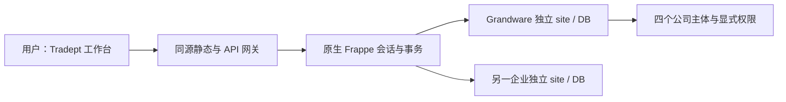

# Tradept 单系统需求与实现边界

版本目标：0.2.0。并行系统保存于 `archive/parallel-systems-v0.1.1`，锚点提交 `287b92407017900a1f58c138af9d522b921ebffe`。本文取代 v1 中“本地 SQLite 工作区 + ERP 同步队列”的实现方案，保留其业务、权限、协作和 Excel 要求。所有当前环境都是测试环境。

## 产品定位

Tradept 是通用外贸订单工作台。Grandware 是首个实际历史数据验证客户；它通过公司、角色、汇率、利润政策和导入配置使用产品。避免另建一套 Grandware 系统。成熟 ERPNext 能力优先替换重复实现；保留现有 logo、简洁布局和毛玻璃视觉。

## 唯一业务数据源

网关不保存业务数据或用户口令，只持有固定路由和签名密钥。历史快照是审计/恢复来源，不是第二个在线数据源。管理员原生管理界面属于同一业务后台，不是另一个需要同步的业务系统。

| 通用需求 | 实现方向与验收 |
| --- | --- |
| 多企业 | 独立 Frappe site/database；相同用户名、记录 ID 不产生跨企业访问 |
| 多公司 | 原生 Company + 明确法人授权，权限缺配置默认拒绝 |
| 多角色 | 原生 User 会话，配置 self/team/tenant 范围与财务字段能力；UI/API/原生 REST 均验证 |
| 账号开通 | 默认管理员配置；原生注册可选，新用户未经企业批准无业务权限 |
| 客户/供应商 | 复用 Customer/Supplier/Contact，稳定记录和联系人 ID |
| 订单先建后完善 | Brief 可无商品明细；完成真实明细后生成原生 SO/PO |
| 收付款 | 原生 Payment Entry 和余额；幂等操作、显式提交，不用累计字段冒充财务流水 |
| 汇率 | 原生 Currency Exchange，按公司配置；正式单据使用冻结汇率 |
| 外贸扩展 | 港口、实际物流日期、生产计划、政策估计和历史参考使用必要扩展 |
| 多人保存 | 同一事务内锁定 revision、CAS、整批验证、审计；冲突保留草稿 |
| Excel | 预览零写入、表头映射、权限裁剪、空值保全和原子提交；历史数据无虚构凭证 |
| 快照 | 恢复也需要当前 revision，不恢复账号权限、不回退原生财务单据 |
| 本地/云部署 | 同一 Frappe app，支持企业本地或固定云后端；私有持久盘与备份 |

## Grandware 历史迁移

当前已有授权本地历史快照，含 21 笔订单、13 个客户和 33 个工厂，包含软删除记录。初始迁移应逐 ID 比较全部字段和关联，保留原始来源哈希。缺失的创建人、历史汇率、商品明细、逐笔收付款保持缺失，不以导入操作人和当前配置填充历史事实。

历史国内运费/其他费用字段虽然旧名含 USD，实际口径为 CNY；旧 insurance 字段实际为退税比例。该规则仅通过明确 Grandware 历史政策兼容。通用正式业务依据原生单据币种和冻结汇率，不能沿用误名字段做隐式会计处理。

## 验收门槛

1. 原始记录、活动/软删除数量、金额和关系初始迁移逐字段一致；没有虚构 SKU、Payment Entry 或 GL。
2. 两个独立站点、四个公司、五类角色：列表、编辑、财务、关联、导出和原生 REST 无越权。
3. 两个用户同时基于同 revision 修改：一方成功，另一方 409，草稿保留；失败批次全部回滚。
4. 新业务从 Brief 到真实 SO/PO，再原生收款，工作台立刻反映同库余额；重复请求无重复单据。
5. 改当前汇率、备注和状态不能重算正式历史金额；快照不能覆盖已提交财务记录。
6. Excel 预览无写入，提交与表单使用相同规则，空列不清空已有值。
7. 重启后 app、配置、数据库和记录仍在；关闭后端时没有旧数据库备用路径。

公网共享测试机目前为 2GB，且同时运行其他应用。本轮先完成隔离本地真实验收；未通过资源评估和迁移验收前，不把新版覆盖到该共享主机。历史公网 0.1.1 与本地新版的版本状态需分别说明。
