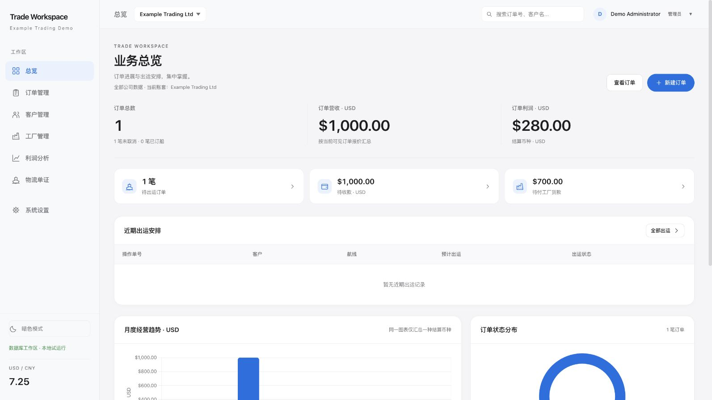
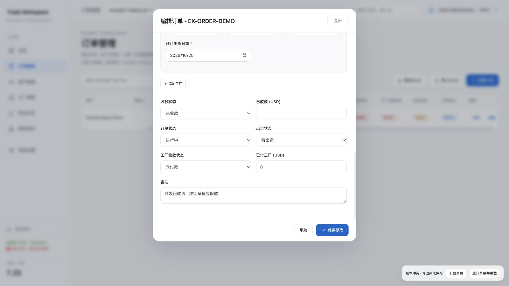

# 本地交付与验证

日期：2026-10-11。验证对象是本地源码与新 API，不是线上发布。总报告见 [代码审查](CODE-REVIEW-20261011.md)，开发基线见 [产品需求 v1](通用外贸订单系统-产品需求-v1.md)。

## 1. 当前预览

- 新数据库工作区：<http://127.0.0.1:3087/#/dashboard>。本机 SQLite 权威数据、配置账号、服务器权限、协作版本和快照。
- 原隔离预览：<http://127.0.0.1:3086/#/dashboard>。读取 Grandware 归档副本，数据保存于浏览器；角色切换仅用于界面演示，没有真实账号或多人数据库保证。
- 新工作区目前有 Grandware Demo 和 Example Trading Demo 两个独立租户。Example 配有虚构客户、供应商、订单；界面验收、并发提交及截图只使用虚构租户。Grandware 副本保持导入版本 1，未提交业务修改。

工作区 ID：`grandware`、`example-company`。演示用户名分别为配置中的 `David`、`demo-admin`；实际用户名以配置/本机口令文件为准。口令全为新生成随机值，不使用原项目公开哈希，也不写入源码或报告。

本机私有运行目录：

```text
/Users/wangyao/.codex/visualizations/2026/10/11/01a12ab3-4b8a-7240-ab2a-0f86986c7d99/.trade-runtime
```

数据库为 `workspace.sqlite3`，演示口令在同目录 `demo-credentials.json`。目录权限 0700，文件 0600；静态服务不允许下载这些文件。此路径是当前本地试运行目录，正式运维需另选受备份保护的企业目录。源码在 SMB 网络盘，服务拒绝把 SQLite 和凭据存到该盘。

## 2. 重启与配置

在 `trade-order-system/` 目录显式使用已验证的 Python 3.12 运行时；本机默认 `python3` 为 3.9.6，不用于本轮启动：

```sh
/Users/wangyao/.cache/codex-runtimes/codex-primary-runtime/dependencies/python/bin/python3 -m server.app --runtime /Users/wangyao/.codex/visualizations/2026/10/11/01a12ab3-4b8a-7240-ab2a-0f86986c7d99/.trade-runtime --port 3087
```

只监听 127.0.0.1；不能据此让远程同事直接访问。公司多人使用需部署同一业务 API 并配置正式网络/HTTPS，不能各自打开不同 SQLite 文件或共用 SMB 数据库文件。

配置文件为 `server/config.example.json`，没有密码值。重新应用配置保留已有口令和业务数据；被禁用或省略账号的会话撤销。租户级 scope 仍须明确法人授权，工厂共享读范围由 `readScopes.factories` 配置。

```sh
/Users/wangyao/.cache/codex-runtimes/codex-primary-runtime/dependencies/python/bin/python3 -m server.cli --runtime /Users/wangyao/.codex/visualizations/2026/10/11/01a12ab3-4b8a-7240-ab2a-0f86986c7d99/.trade-runtime configure --config server/config.example.json
```

只在新环境首次初始化时使用 `init`；当前演示已初始化、导入和核对，无需再次导入。若确需重新导入，CLI 必须给当前 expected-version，且先备份/核对。更多 API、账号重置和数据导入操作见 [server README](../server/README.md)。

## 3. 自动化验证

| 验证                                               | 结果                                 | 实际覆盖                                                                                                                                                          |
| -------------------------------------------------- | ------------------------------------ | ----------------------------------------------------------------------------------------------------------------------------------------------------------------- |
| `npm test -- --runInBand`                          | 13 suites、614 项通过，71.635 秒     | 原有模块回归、新 API ACK/409/字段补丁、草稿、表单读取基线、原表头、角色受限编辑、利润币种/公式、稳定 ID、失败重试、输入安全                                       |
| `python3 -m unittest server.tests.test_service -v` | 42 项通过，6.673 秒                  | 真实临时 SQLite、真实 loopback HTTP、租户/法人/记录/字段、随机会话/禁用/过期/限流、CAS 两客户端、整批回滚、软删除、唯一号、关联、快照/恢复、ID 校验、静态资源保护 |
| 独立二轮增量复核                                   | 12 个合成场景通过                    | 11 个违规操作拒绝且 payload/rates/metas/revision/时间/actor/审计/快照数不变；公开工厂重排成功且隐成本、嵌套银行和历史收入/利润保持                                |
| `npm run lint`                                     | 0 错误、0 警告                       | js 运行模块                                                                                                                                                       |
| `npm run format:check`                             | 所有匹配 js 文件通过                 | Prettier 格式                                                                                                                                                     |
| Grandware 导入核对                                 | 全部原业务字段、汇率相等，revision=1 | 21 订单/13 客户/33 工厂，含软删；只新增 tenantId。见 JSON 核对文件                                                                                                |

Jest 中网络失败、409、畸形草稿等错误日志是对应断言的故障场景，不是漏报保存成功。旧 CloudBase mocked 测试通过只证明旧算法行为；新数据库防覆盖结论来自 CAS/真实 HTTP 及浏览器验收，不来自旧合并测试。

## 4. 浏览器验收

1. 配置账号登录、退出与重新登录正常；租户名称、法人、名录和业务数据切换到 Example，没有 Grandware 订单混入。
2. Grandware 设置页实际显示导入版本 1、四法人汇率及版本 0/1 快照。仅做读取；没有点击修改其汇率或恢复。
3. Grandware 利润页可分别选择 CNY/USD，图表与明细只汇总所选币种；历史利润保持原存值，未将客户数据截图对外输出。
4. Example 两页面同时打开同一订单表单。A 提交成功；B 提交收到 409，页面显示“版本冲突，修改尚未保存”，表单 B 备注仍在。真实数据库保留 A。B 草稿下载成功，JSON 包含 tenantId/baseVersion 和 B 内容，只含 Example 记录。
5. 修复表单打开期间的轮询边界：自动/手动读取不能推进编辑基线；在读取飞行中打开表单也不接纳新基线。相应 API/DB 回归通过。合法删除最后一条记录的空集合会被正常同步，不再被旧“数据异常”保护误拒。
6. B 在冲突后刷新仍恢复旧版本草稿并提示冲突；明确确认放弃后读取 A 的数据库内容。冲突放弃、快照恢复使用工作区内确认框；恢复仍按确认前版本 CAS。恢复或重新读取成功后清除旧保存错误状态。快照恢复执行由后端真实 HTTP 测试验证，未在 Grandware 副本上执行恢复。





## 5. 未交付边界

本轮运行服务未连接线上数据库，也没有迁移/部署线上。公开 v40 静态脚本已只读核验；实际生产安全规则、全量原始文档与云函数部署未验证。

新业务 API 的默认入口需要 API 服务；原静态 CloudBase 发布工作流已改为验证流程，防止误发布。GitHub CI 尚未真实执行（工作区无 Git 仓库/远程），不能把本机通过说成 CI/上线通过。旧 CloudBase 代码保留为历史兼容材料，新服务不使用公开哈希登录、匿名整包写或旧清理链路。

企业本地/云 PostgreSQL、任意 ERP 数据库映射、可编辑工作表、完整财务账本/金额迁移、逐记录并发、幂等请求、收费以及生产 HTTPS/运维备份仍未实现。业务快照不能替代独立数据库备份；当前 SQLite 和 JSON 金额模型不构成高可用或完整财务系统。
